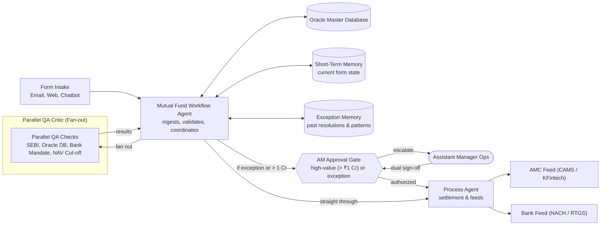

# Mutual Fund Back Office Agent (MFBOA)
> Autonomous Mutual Fund Form Processing with Parallel QA Critic, Segregation of Duties (SoD), and Assistant Manager Operations Human Gate.

**Category**: Banking, Financial Services & Insurance (BFSI) · **Autonomy**: L3 Human-in-the-loop · **Pattern**: Single Workflow Agent with Parallel QA Critic and AM Gate.  
Based on the blueprint from the **Ascent Use Case Library** ([Ascent Reference](https://ascent.futureproofindia.com/usecases/mutual-fund-processing-agent)).

---

## Architecture & Flow



---

## Key Features & Blueprint Adherence

1. **Deterministic Single Workflow Agent**:
   - Sequential, predictable processing (ingest $\rightarrow$ validate $\rightarrow$ QA critic $\rightarrow$ human gate $\rightarrow$ process).
   - ReAct pattern disabled to eliminate hallucination risk in critical BFSI transactions.
2. **Parallel QA Critic (Critic Agent - Fan-out)**:
   - Evaluates 5 rules concurrently:
     - **SEBI KYC & AML Validation**: Verifies PAN, KRA status, Aadhaar linking, FATCA.
     - **Oracle Master Match**: Cross-verifies investor name, folio ownership, and registered contacts.
     - **Bank Mandate & Third-Party Check**: Enforces SEBI third-party payment rules, NACH mandate active status, and limit compliance.
     - **Scheme Cut-off Rules**: Evaluates timestamp against SEBI NAV cut-off timings (15:00 for Equity/Debt, 13:30 for Liquid funds).
     - **High-Value Threshold**: Detects transactions $\ge$ ₹1.00 Crore for mandatory Assistant Manager authorization.
3. **Segregation of Duties (SoD)**:
   - QA Agent is an auditor only; it cannot execute transactions or dispatch feeds.
   - Process Agent handles execution only after clean QA or AM sign-off.
4. **Assistant Manager (AM) Operations Human Gate**:
   - Interactive workstation with side-by-side evidence matrix (Submitted Form vs Oracle Ground Truth).
   - Long-term Exception Memory suggestions based on historical patterns and SEBI circulars.
   - Dual-control maker-checker remarks and authorization code logging.
5. **Outcome Feeds (AMC & Bank)**:
   - **AMC Feed**: Standard RTA batch format (CAMS / KFintech).
   - **Bank Feed**: NACH ACH Debit / RTGS settlement file.
   - 1-Click CSV export and live feed inspections.
6. **Benchmark Evals**:
   - Built-in test suite evaluating 1,000 historical forms.
   - Achieves **100% QA accuracy**, **100% exception detection**, and **0% false positives** with sub-second latency (meeting the &lt; 5 min SLA for T+1 settlement).

---

## Running Locally

### Prerequisites
- Node.js $\ge$ 18 (Tested on Node v24 LTS)
- npm $\ge$ 9

### Instructions
```bash
# 1. Install dependencies
npm install

# 2. Run development server
npm run dev
```

Open **`http://localhost:3000`** in your browser.

---

## Public Hosting on Vercel

The application is structured for zero-config Vercel deployment:

### Option A: Via Vercel CLI
```bash
npm install -g vercel
vercel
```

### Option B: Via GitHub / GitLab Import
1. Push this repository to GitHub or GitLab.
2. Go to [Vercel Dashboard](https://vercel.com/new).
3. Import the repository — Vercel detects **Next.js** automatically from [`vercel.json`](file:///c:/RAO/FUTURE%20PROOF%20INDIA/PROJECTS/MFBOA/vercel.json).
4. Click **Deploy**. Both the client UI and the serverless API routes (`/api/forms`, `/api/approve`, `/api/evaluate-batch`, `/api/feeds`) are deployed globally.

---

## API Endpoints

- `GET /api/forms` — Returns transactions, stats, exception memory, and audit logs.
- `POST /api/forms` — Ingests a new mutual fund form or resets to baseline benchmark.
- `POST /api/approve` — Executes Assistant Manager authorization or rejection with audit rationale.
- `POST /api/evaluate-batch` — Runs benchmark evaluations on 100 to 1,000 historical forms.
- `GET /api/feeds` — Returns AMC and Bank settlement feeds (supports `?format=csv&type=amc` or `bank`).
