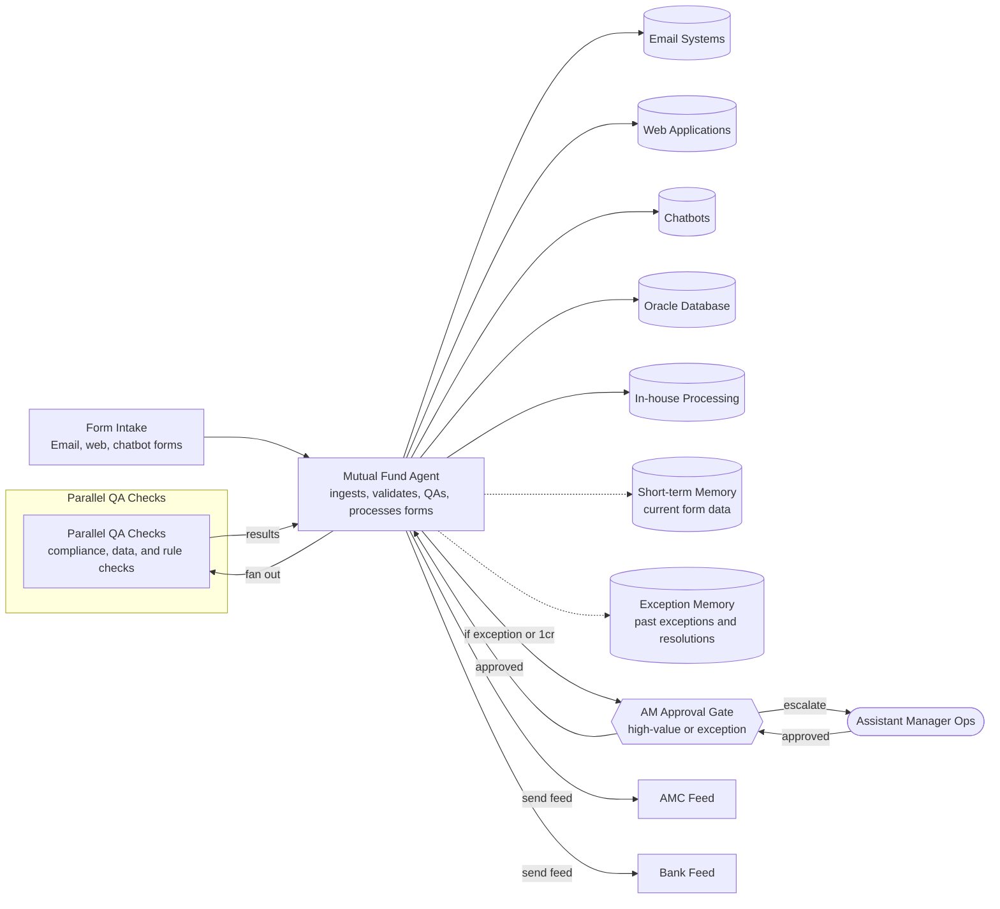

# Mutual Fund Back Office Agent

> Automates mutual fund form processing with QA and exception handling.

Category: Banking, Financial Services & Insurance · Autonomy: L3 · Pattern: Single workflow agent with parallel QA and human gate

## How to use this brief

This is a design blueprint from the Future Proof India Use Case Library, not a full specification. Build the *first slice* described at the end with synthetic or sample data. Keep every human approval and guardrail below. Do not invent integrations, credentials or data you were not given; ask when something is unclear. For a build-ready spec (API endpoints, data model, acceptance criteria, threat model, deployment plan), continue in Agent Spec Studio from the use case page, then hand that spec to your coding agent.

## Problem statement

Investors submit mutual fund forms online through web applications, chatbots, or email. A team of 29 staff manually processes 5000-7000 forms daily, with 20 QA assistants auditing each form. This manual process is error-prone and delays settlement beyond T+1 days.

## Constraints

Must comply with SEBI regulations, AMC rules, and RTA guidelines. Data access is restricted to authorised personnel. Accuracy must be 100% for QA, and transactions above one crore require Assistant Manager approval.

## Solution overview

The agent ingests forms from email, web, and chatbots, validates data against Oracle DB, and performs automated QA. It flags exceptions for human review. Approved transactions are processed and feeds sent to AMC and bank. Assistant Manager Operations approves high-value or exception transactions.

## Tools & integrations

Email systems, web applications, chatbots, Oracle Database, in-house processing applications.

## Single-agent or multi-agent

Multi agent. QA Agent handles all form types and integrates with existing systems. Process-agent will process the trasnsactions. QA & Process should not be performed by one agent as Sod conflit arises.

## Agentic patterns used

Tool use for database and application access, Workflow for sequential processing, Human-in-the-loop for exception approvals.

## ReAct vs Workflow vs Hybrid

Workflow. The process follows a fixed sequence: ingest, validate, QA, approve, process. ReAct is not needed as steps are deterministic.

## Memory

Short-term memory holds current form data during processing. Long-term memory stores past exceptions and resolutions for pattern recognition.

## Interface

Triggered by form submission via email, web, or chatbot. Human interaction through a dashboard for exception review and approval.

## Guardrails

Must never process transactions without required approvals. PII must be encrypted and access logged. All exceptions require human approval. Compliance with SEBI and RTA rules is mandatory.

## Evals

Test set of 1000 historical forms with known outcomes. Bar: 100% accuracy on QA, 99% on exception detection. False positives must be below 1%.

## Autonomy level

L3. The agent processes routine transactions automatically but requires human approval for exceptions and high-value transactions.

## Model preference

Mid-size model. Balances accuracy and cost for structured form processing. Frontier model not needed for deterministic tasks.

## Cost considerations

Driven by API calls for validation and database queries. Keep costs down by batching forms and caching frequent validations.

## Latency considerations

Must process each form within 5 minutes to meet T+1 settlement. Design uses parallel processing for independent forms.

## First slice to build

Build agent for new purchase forms only. Next, add switch and redemption forms, then integrate with AMC and bank feeds.

## Architecture

Single workflow agent with parallel QA and human gate. The process is deterministic and centralised, so one workflow agent ingests, validates, and processes forms, with parallel QA checks and a human gate for exceptions and high-value transactions.

Guardrails drawn on the diagram:
- No processing without approval
- PII encrypted and access logged
- Exceptions need human approval
- SEBI and RTA compliance enforced
- 100% QA accuracy required

---
Source: https://ascent.futureproofindia.com/usecases/mutual-fund-processing-agent
Future Proof India · Ascent Use Case Library
